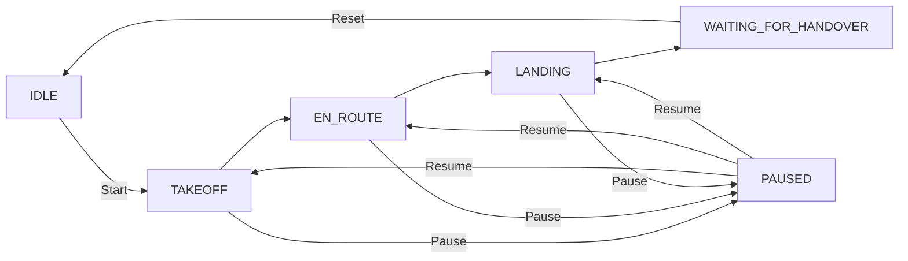

# Thử nghiệm CesiumJS — UAV Delivery System

**Giai đoạn:** 1 — Phân tích, thiết kế và kiểm chứng công nghệ  
**Ngày:** 8 — Thử nghiệm 3D Visualization  
**Thành phần:** CesiumJS / Cesium Sandcastle  
**Mức độ:** Proof-of-concept; chưa tích hợp Backend, Database, Socket.IO hoặc Virtual Flight Controller.

## 1. Mục đích

- Xác minh CesiumJS có thể hiển thị địa cầu/bản đồ 3D trên trình duyệt.
- Xác minh Cesium Entity API cho phép hiển thị trạm xuất phát, điểm giao, waypoint, tuyến bay và UAV.
- Xác minh nội suy theo khoảng cách giúp di chuyển UAV trên tuyến cố định.
- Thử thao tác Start/Pause/Resume/Reset, hiển thị HUD đơn giản.
- Xem xét những chức năng phải thực hiện thêm ở Giai đoạn 2–4.

## 2. Phạm vi mô hình

- Một trạm `STATION-01`.
- Ba UAV `UAV-01`, `UAV-02`, `UAV-03`.
- Một đơn hàng giả định `ORD-001`, một nhiệm vụ giả định `MIS-001`, một điểm giao `POINT-A`.
- UAV-01 di chuyển trên đường gồm 3 waypoint; hai UAV còn lại đứng yên dưới dạng marker.
- Một vùng cấm bay được minh họa trên bản đồ, **chưa có thuật toán kiểm tra va chạm vùng cấm**.
- Trình duyệt tự tiến hành cập nhật hình ảnh; **không có server simulation tick**.

## 3. Tọa độ thí nghiệm

| Thành phần | Kinh độ (lon) | Vĩ độ (lat) | Độ cao minh họa |
|---|---:|---:|---:|
| STATION-01 | 105.8542 | 21.0285 | 0 m |
| WP-01 | 105.8559 | 21.0303 | 45 m |
| WP-02 | 105.8576 | 21.0323 | 45 m |
| WP-03 | 105.8593 | 21.0338 | 45 m |
| POINT-A | 105.8614 | 21.0353 | 0 m |

- Các vị trí nằm trong khu vực minh họa tại Hà Nội, không được xác nhận là địa điểm có thể giao UAV ngoài đời thực.
- Tổng khoảng cách tuyến ngang xấp xỉ 1,07 km (cộng khoảng cách các đoạn theo Haversine), gần hơn khoảng cách bay thực do chưa tính chiều cao/điều kiện khí động học.
- Cesium dùng `Cartesian3.fromDegrees(longitude, latitude, height)`, không đảo thứ tự vĩ/kinh độ.

## 4. Luồng thử nghiệm

**Lưu ý:** Đây là các trạng thái *mô phỏng giao diện thí nghiệm*, không phải toàn bộ state machine chính thức (`PRE_FLIGHT_CHECK`, `APPROACH`, `RETURNING`, `EMERGENCY_LANDING`...) đã thiết kế ở Ngày 3–4. Không dùng logic này làm Flight Controller sản phẩm.

## 5. Thông số giả lập

- Vận tốc bay ngang: 6 m/s.
- Bay lên: 3 m/s (đơn giản hóa).
- Hạ độ cao: 2 m/s (đơn giản hóa).
- Độ cao bay trên ellipsoid: 45 m.
- Tăng tốc thời gian demo: 8×, nhằm rút ngắn bài thực hành.
- Pin khởi đầu minh họa: 90%; tụt tuyến tính theo số giây mô phỏng — **không phải pin thật**.

## 6. Giao diện

- Cesium Viewer (`cesiumContainer`) hiển thị địa cầu và scene 3D.
- Entities: trạm, 3 waypoint, điểm giao, tuyến 3D, UAV-01 dạng hình học Cesium, 2 UAV marker.
- Panel HUD: Flight state, Battery, Altitude, Distance, Progress, Simulated time.
- Buttons: Start, Pause, Resume, Reset, Focus UAV, Overview.

## 7. Rủi ro và giới hạn

1. Chưa có đăng nhập hoặc phân quyền; dữ liệu cứng trong JavaScript.
2. Chưa có PostgreSQL, Express REST API hay Socket.IO.
3. Đóng tab sẽ kết thúc mô phỏng; trái với yêu cầu BR-10 của sản phẩm. Điều này chỉ được chấp nhận trong *tech spike*. Ở Giai đoạn 4, mô phỏng phải chạy độc lập trên server.
4. Chưa thực hiện logic pin an toàn, mức dự trữ 30%, kiểm tra tải trọng, vùng cấm bay và xác nhận giao hàng.
5. UAV thể hiện bằng hình học vẽ tại tọa độ hiện tại; chưa nhập glTF UAV thực tế.
6. Độ cao đo từ ellipsoid WGS84; không thay thế độ cao địa hình thực địa.
7. Không được dùng mô hình này để điều khiển chuyến bay thật.

## 8. Kết luận kỹ thuật

CesiumJS phù hợp làm **lớp hiển thị 3D** của hệ thống. Tại Giai đoạn 2 cần dựng React+Cesium component và quản lý entity, di chuyển theo waypoint; Giai đoạn 3/4 cần thay logic cập nhật trong browser bằng telemetry từ Simulation Engine thông qua Socket.IO. Figma chỉ mô tả UI, CesiumJS triển khai bản đồ.

## 9. Minh chứng thực hành cần lưu

- `screenshots/cesium-initial.png`: bản đồ trước khi bay.
- `screenshots/cesium-en-route.png`: UAV giữa tuyến.
- `screenshots/cesium-paused.png`: HUD trạng thái PAUSED.
- `screenshots/cesium-handover.png`: UAV đến điểm giao và ở WAITING_FOR_HANDOVER.

Tên file ảnh là **gợi ý cho ảnh do nhóm tự chụp**; bộ thực hành chưa có các ảnh này.
