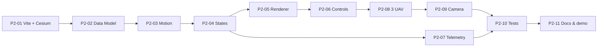

# BACKLOG GIAI ĐOẠN 2 — MÔ PHỎNG UAV CƠ BẢN

**Xuất phát điểm:** Ngày 8 đã có tech spike trên Sandcastle; đến Giai đoạn 2, cần biến thử nghiệm đó thành module mô phỏng có thể tái sử dụng, tách dữ liệu/trạng thái khỏi phần vẽ 3D.

**Những thứ chưa yêu cầu làm ngay:** PostgreSQL production, đăng nhập JWT, app Capacitor/Electron, Safety Manager đầy đủ và điều khiển UAV thật. Chúng nằm ở các giai đoạn sau.

## Sprint Giai đoạn 2 — Product Backlog

| ID    | Ưu tiên | Module        | Công việc                                                                                                      | Definition of Done                                          | Phụ trách gợi ý |
| ----- | ------- | ------------- | -------------------------------------------------------------------------------------------------------------- | ----------------------------------------------------------- | --------------- |
| P2-01 | P0      | Repo / App    | Tạo workspace chạy bằng Vite + CesiumJS (từ source Ngày 8)                                                     | `npm run dev` mở được bản đồ, không lỗi Console             | TV1 + TV3       |
| P2-02 | P0      | Data Model    | Dùng một cấu trúc object cho station, delivery points, 3 UAV, waypoint và mission                              | Không hardcode cùng một dữ liệu ở nhiều nơi                 | TV3             |
| P2-03 | P0      | Motion        | Tính tọa độ UAV theo `dt` và waypoint; xử lý đến waypoint/đích                                                 | Unit tests `distance` và `route progress` đạt               | TV3             |
| P2-04 | P0      | State         | Mô hình hóa state tối thiểu IDLE/TAKEOFF/EN_ROUTE/LANDING/PAUSED/WAITING_FOR_HANDOVER                          | Lệnh sai trạng thái bị từ chối; có unit tests               | TV3             |
| P2-05 | P0      | Renderer      | Tách controller/motion model khỏi Cesium renderer                                                              | Cùng dữ liệu state có thể in console mà không chạy Cesium   | TV1 + TV3       |
| P2-06 | P0      | Controls      | Start/Pause/Resume/Reset hoạt động, UI hiển thị trạng thái đồng nhất                                           | Demo được 1 tuyến đầy đủ, không nhảy vị trí khi resume      | TV1             |
| P2-07 | P1      | Telemetry     | Payload chuẩn `{droneId, missionId, simulationTimeMs, lat, lon, altitudeM, speedMps, batteryPct, flightState}` | Cập nhật bảng telemetry theo tick, test kiểu dữ liệu        | TV2 + TV3       |
| P2-08 | P1      | Three UAV     | Hiển thị 3 UAV, mỗi UAV có state và vị trí riêng                                                               | Một UAV bay không làm đổi vị trí UAV khác                   | TV3             |
| P2-09 | P1      | Camera        | Focus UAV/Overview, hiển thị route/waypoints đúng                                                              | Camera không khóa ngoài ý muốn; có test manual              | TV1             |
| P2-10 | P1      | Validation    | Test các trường hợp khởi tạo thiếu waypoint, vị trí lệch, pause khi chưa bay                                   | Có test logs và xử lý lỗi có thông báo                      | TV3             |
| P2-11 | P1      | Documentation | Mô tả thuật toán bước thời gian, tốc độ, alt, đơn vị, mô phỏng vs thực tế                                      | `docs/03-simulation/` được cập nhật và review               | Cả nhóm         |
| P2-12 | P2      | UX            | Trạng thái Loading/Empty/Error và responsive sơ bộ                                                             | Bản demo đọc được trên desktop; mobile cần test ở Phase 5/6 | TV1             |

## Phụ thuộc và thứ tự triển khai

## Tiêu chí nghiệm thu Giai đoạn 2 (dự kiến)

- [ ] Mở app mô phỏng cục bộ được bằng lệnh rõ ràng.
- [ ] UAV-01 bay qua waypoint và tới Delivery Point trên bản đồ 3D.
- [ ] Start/Pause/Resume/Reset hoạt động nhất quán với trạng thái và vị trí.
- [ ] Telemetry có đơn vị, phản ánh state của mô phỏng.
- [ ] UI renderer không sở hữu quy tắc chuyển trạng thái chính.
- [ ] Có test unit motion/state và minh chứng màn hình.
- [ ] Nhóm biết rõ những giới hạn còn chờ Giai đoạn 3–4 (Backend độc lập, battery model và safety đầy đủ).

## Rủi ro cần lưu ý

1. **Không gọi tech spike Sandcastle là server-side Simulation Engine.** Giai đoạn 2 cần kiểm chứng tách engine khỏi renderer; yêu cầu `đóng UI vẫn chạy` chỉ có thể nghiệm thu khi đã có tiến trình engine phù hợp ở các giai đoạn sau.
2. Cần thống nhất **đơn vị** (mét, giây, m/s, % pin; lat/lon độ) và Clock Simulation.
3. Không tự dùng API demo Ngày 6 làm nguồn điều khiển mô phỏng nếu chưa thiết kế đồng bộ state và command ACK.
4. Thống nhất khái niệm Order/Mission/Flight State trước khi viết mới.

## Handoff — quyết định của nhóm

- Ngày chốt: [ĐIỀN]
- Đầu việc P0 giao cho TV1/TV2/TV3: [ĐIỀN]
- Branch Git: [ĐIỀN]
- Task đầu tiên: P2-01 — Tạo workspace Vite + CesiumJS.
